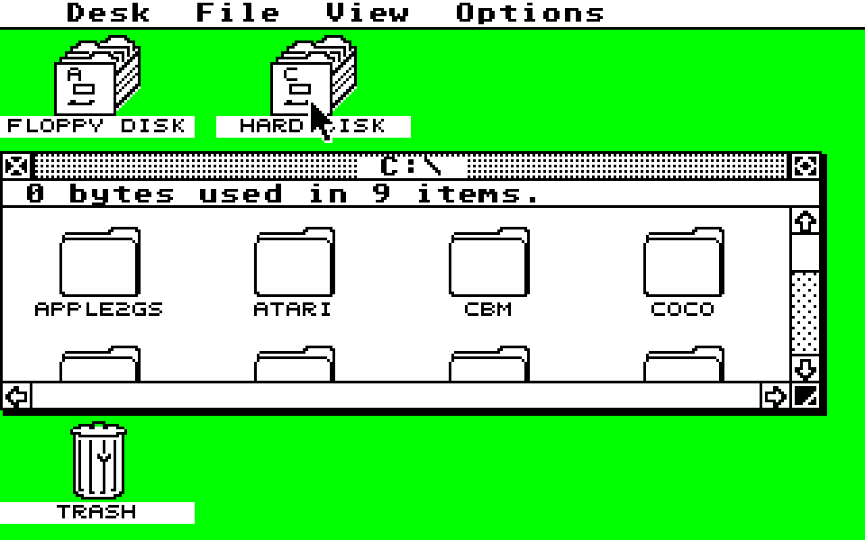
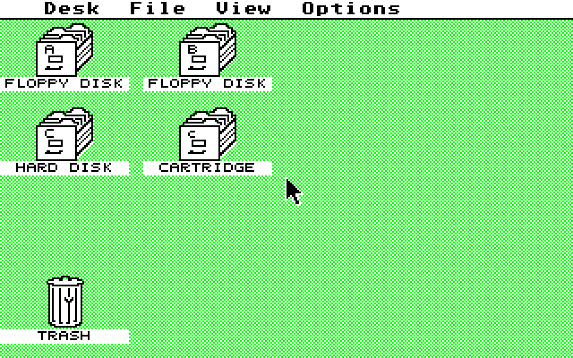
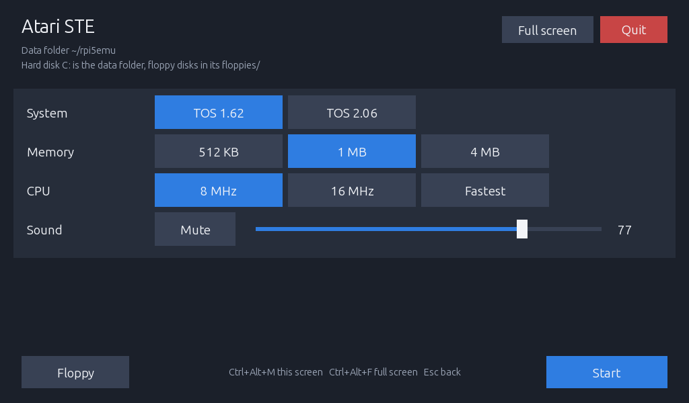
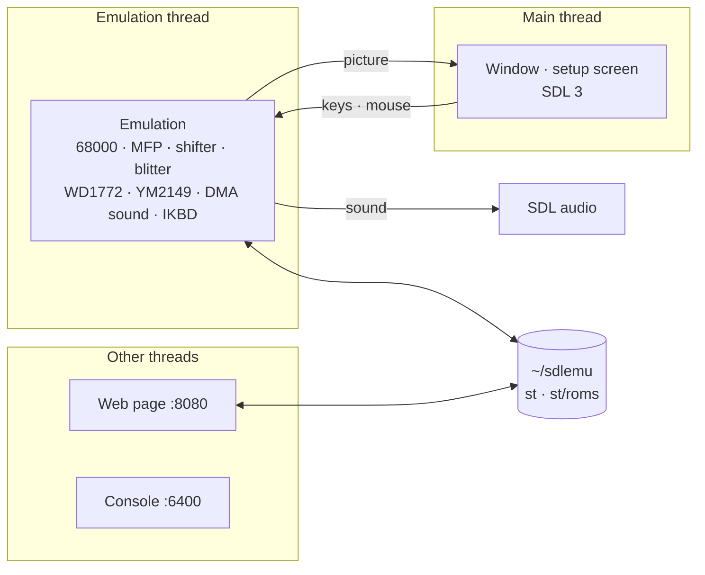

<h1 align="center">sdlste</h1>

<p align="center">
  <b>An Atari STE in an SDL 3 window on Linux or macOS.</b><br>
  68000 at 8 MHz (also 16 MHz or as fast as it goes), TOS 1.62 / 2.06, up to 4 MB, floppies, hard disk, ACSI hard disk images.
</p>

<p align="center">
  
  
  
  
  
  
</p>

<p align="center">
  <b>Work in progress:</b> not everything has been tested, and games and demos may or may not
  work satisfactorily.
</p>

<p align="center">
  
  
  <br>
  <sub>TOS 1.62's desktop with drive C: (the data folder) open, and TOS 2.06's with 4 MB, on the Pi.</sub>
</p>

sdlste runs [esp32ste](https://github.com/rlucencic/esp32ste)'s STE on 64-bit Linux (arm64 and amd64) and Apple Silicon macOS. SDL 3 provides the window, sound and input. The machine is the
same code as on the ESP32 boards: esp32ste's platform-independent core and
[esp32emu](https://github.com/rlucencic/esp32emu)'s CPU core, on
[sdlemu](https://github.com/rlucencic/sdlemu), the family's desktop runtime: a setup
screen in the window, sound, the host's keyboard and mouse, a web page on your network and a
console.

It belongs to the SDL desktop family of the ESP32 emulators:
[sdlzx](https://github.com/rlucencic/sdlzx) (ZX Spectrum),
[sdlcpc](https://github.com/rlucencic/sdlcpc) (Amstrad CPC),
[sdlcbm](https://github.com/rlucencic/sdlcbm) (Commodore 64 and 128),
[sdlcoco](https://github.com/rlucencic/sdlcoco) (Tandy Color Computer 2 and 3),
[sdlgs](https://github.com/rlucencic/sdlgs) (Apple IIGS),
[sdlmsx](https://github.com/rlucencic/sdlmsx) (MSX1 and MSX2),
[sdlxl](https://github.com/rlucencic/sdlxl) (Atari 800XL and 130XE),
[sdlpc](https://github.com/rlucencic/sdlpc) (IBM PC/XT and PC/AT),
[sdlmac](https://github.com/rlucencic/sdlmac) (Macintosh Plus, SE, Classic),
[sdlmac2](https://github.com/rlucencic/sdlmac2) (Macintosh LC and II),
[sdlmac3](https://github.com/rlucencic/sdlmac3) (Macintosh LC II and LC III),
[sdlarc](https://github.com/rlucencic/sdlarc) (Acorn Archimedes),
[sdlami](https://github.com/rlucencic/sdlami) (Amiga 500, 2000, 600, 1200).

## Features

**The machine**
- 68000 ([Musashi](https://github.com/kstenerud/Musashi) core) at **8 MHz** like an STE. Also
  faster, like an accelerator board: **16 MHz**. The rest of the machine
  keeps the STE's timing; the choice applies at once, no restart
- Real time at 8 MHz on the Pi with most of a core to spare
- TOS 1.62 or 2.06, chosen on the setup screen
- 512 KB, 1 MB or 4 MB of RAM
- Low, medium and high resolution on one screen, like a multisync monitor;
  Set Preferences offers all three, and the last one is remembered
- Blitter, YM2149 and STE DMA sound, MFP 68901, IKBD with the clock set from the Pi's time

**Disks**
- **Hard disk C:** the data folder, at file level: copy programs into it
  from the Pi or over the network, no disk image or driver needed
- **Floppy drives A: and B:** `.ST` images (read and written) and `.MSA`
  images (read-only), with a WD1772 controller that TOS can format disks on
- **New blank disks** from the setup screen: `EMPTY0001.ST`, `EMPTY0002.ST`, …
- A disk in A: at power-on boots, as games expect

**Around it**
- **A window** of its own on the Pi's desktop (X11 or Wayland), resizable, full screen
  with Ctrl+Alt+F; the picture in the machine's shape, sharp pixels
- **Setup screen** in the window, first thing at start and any time with Ctrl+Alt+M:
  TOS, memory, CPU speed, the sound's volume, the drives and their images (insert, eject, new
  blank ones), Start / Back / Restart, Reset
- **The Pi's keyboard and mouse**: keys by position, as the boards' Bluetooth keyboards;
  a click in the window gives the mouse to the machine, Ctrl+Alt+G takes it back
- **Web page** at `http://<the Pi>:8080/`: drop images (or ZIP files) onto it, insert
  them, make blank ones, and watch the machine and its drives live
- **Sound** through SDL (PipeWire, PulseAudio or ALSA), the machine paced by the clock
- **Console** on the terminal and on `127.0.0.1:6400`: keys, typing, drives, screenshots

<p align="center">
  
  <br><sub>The setup screen in the window, before the STE starts</sub>
</p>

## Getting started

### 1. What you need

- 64-bit Linux (including Raspberry Pi 5) or Apple Silicon macOS with SDL 3.2 or newer. See [desktop build dependencies](https://github.com/rlucencic/sdlemu#building).
- [esp32emu](https://github.com/rlucencic/esp32emu), [sdlemu](https://github.com/rlucencic/sdlemu)
  and [esp32ste](https://github.com/rlucencic/esp32ste), cloned next to this project
- The ROMs (below)

### 2. Build

```sh
git clone https://github.com/rlucencic/esp32emu.git
git clone https://github.com/rlucencic/sdlemu.git
git clone https://github.com/rlucencic/esp32ste.git
git clone https://github.com/rlucencic/sdlste.git && cd sdlste
cmake -S . -B build -G Ninja && cmake --build build
```

### 3. ROMs

`tos162.img` and/or `tos206.img` in the data folder's `st/roms/`
(`~/sdlemu/st/roms`), named as esp32ste's. Not part of this repository.

### 4. First start

1. `build/sdlste`: the setup screen opens in a window.
2. Choose the TOS and click **Start**.
3. Put images into `~/sdlemu/st/` (floppies `.ST`, `.MSA`; hard disks `.IMG`, `.HD`),
   drop them on the window or the web page, and insert them on the setup screen's **Disks** page.

## Using it

| To | Do |
|---|---|
| Get back to the setup screen | Ctrl+Alt+M (the machine waits meanwhile) |
| Full screen | Ctrl+Alt+F |
| Give the mouse to the machine, take it back | A click in the window; Ctrl+Alt+G |
| Run as fast as it goes (warp) | Ctrl+Alt+W, again for real speed |
| Take a screenshot | Ctrl+Alt+S (into `~/sdlemu/screenshots`), or the console's `s` |
| Insert an image | The setup screen's **Disks** page, drop it on the window or the web page, or name it on the command line: `build/sdlste game.st` |
| Start straight into the machine | `build/sdlste -S`, with the setup screen's rows as `--choice`: `build/sdlste -S --choice "System=TOS 2.06" --choice "Memory=4 MB"` |
| Show the window on another computer | Log in with `ssh -C -Y <the Pi>` and start it there: fine for still pictures; games want the Pi's own monitor |
| Make a blank floppy | Setup screen → **Disks** → **New empty disk** |
| Use a hard disk image | Insert it into **ACSI 0** on the **Disks** page and reset: with a driver on it (AHDI, HDDRIVER, ICD, PPDriver) TOS boots from it, its partitions are C: onward and `~/sdlemu` the next letter |
| Use programs from the Pi | Copy them anywhere into `~/sdlemu`: it's drive C: |

Images live in `~/sdlemu/st/`, settings in `~/.config/sdlemu/settings.ini`; the
inserted images are remembered across starts. `build/sdlste --help` lists the options.

## How it works



- **[esp32ste](https://github.com/rlucencic/esp32ste)'s `components/atari_st`**: the STE,
  platform independent: the same code runs on the ESP32 boards.
- **`src/`**: the glue, esp32ste's `main/main.c` ported: memory, ROMs, settings, keyboard map,
  drives and status.
- **[sdlemu](https://github.com/rlucencic/sdlemu)**: the window, the setup screen, sound,
  input, the web page, the console, the data folder and the settings.
- **[esp32emu](https://github.com/rlucencic/esp32emu)**: the CPU core (Musashi 68000).

## Development

```sh
../sdlemu/tools/pi.sh sdlste build        # from another computer: sync to the Pi, build there
../sdlemu/tools/pi.sh sdlste run          # its window on this computer (ssh -C -Y)
../sdlemu/tools/pi.sh sdlste headless     # no window: drive it through the console
../sdlemu/tools/console.sh i 's /tmp/shot.png'
```

`CLAUDE.md` has the details: the layout, how it was ported, the checks; esp32ste's own
`CLAUDE.md` has the machine's.

## Limitations

- Checked on the Pi through its console and screenshots: TOS 1.62 and 2.06 at full speed to the desktop; C: opened with a double click. By hand in the
  window (forwarded to a Mac): TOS 2.06 and the mouse. ACSI: HDDRIVER's demo image booted (headless), its C: opened, `~/sdlemu` D:. Not yet with the sound
  heard, or with much software.
- Over X forwarding (`ssh -Y`) every changed picture crosses the network: 8 to 15 a second, about 7 to a Mac
  (XQuartz, drawn in software).
- `.STX` (Pasti) images of copy-protected originals don't work; `.MSA`
  images are read-only.
- No FPU, MIDI or Mega STE hardware.
- Floppy access is faster than a real drive, which a few loaders may notice.

## Credits

- [Musashi](https://github.com/kstenerud/Musashi) by Karl Stenerud (MIT
  licence), via Matt Evans' [fork](https://github.com/evansm7/Musashi) for
  embedded use
- The Atari ST community's documentation of the hardware, and
  [Hatari](https://www.hatari-emu.org) as the reference for how it behaves
- [SDL](https://libsdl.org) 3 for the window, the sound and the input

## Licence

[MIT](LICENSE).

Atari, ST and TOS are trademarks of their respective owners. This project
contains no Atari code; you need your own TOS ROM images.
